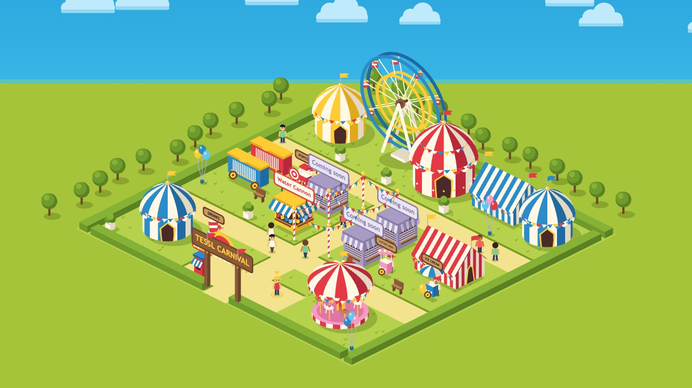

# Tessl Carnival



Your coding agent writes code fast. Turning issues into pull requests, reviewing
them and keeping the repo healthy still waits on you. This repo is where you
build a software factory to take that work on, one skill at a time.

A **software factory** is a set of loops on your repository. Each loop is a
skill that runs on its own: when something happens, such as a label on an issue
or a time on the clock, an agent does one job the way the skill describes, and
code review checks the result before you merge.

## The workshop

Tessl Carnival is the starter repo for **Build your own software factory with
context**, a 90-minute hands-on workshop at AI DevCon New York. Everyone in the
room builds on this same repo, so you can compare notes with the person next to
you.

You'll set up a factory on your fork from your own coding agent, then:

- **Ship an issue without writing code.** Label it, and an agent opens the pull
  request.
- **Teach the factory your rules.** Code review checks every pull request
  against the carnival's house rules, and the agent fixes what it flags.
- **Add a maintenance loop.** It runs on a schedule, finds problems such as
  stale docs or weak tests, and files them as issues for the factory to fix.

In the last 10 minutes you take it home: set up the same factory on a repo of
your own, or keep going here. [`WORKSHOP.md`](WORKSHOP.md) has every step,
module by module.

**Bring:** a laptop with git, Node 24 or later (or Node 22 from 22.13, or Node
20 from 20.19), a coding agent (Claude Code, Cursor, Codex or similar), a GitHub
account, the [GitHub CLI](https://cli.github.com) logged in with
`gh auth login`, and the [Tessl CLI](https://tessl.io).

**Facilitators:** Hamza Oza, James Moss and Joe Holdcroft, from Tessl. Raise
your hand at any point and one of us will come over.

## The carnival

The carnival is a small browser game. It ships with one game, the **water
cannon**, and a midway you walk around: a sunny fairground with tents, rides and
a booth for every game. Empty booths say "coming soon" until a game fills them.

You grow your carnival by adding games through your factory. Each game lives in
its own folder, and the only shared file it touches is the game list in
`src/games/index.ts`. Several games can be built at once with little to clash
over, and everyone ends the session with a different carnival.

## Get it running

You need git and Node 24 or later (or Node 22 from 22.13, or Node 20 from
20.19). Fork this repository on GitHub, clone your fork, then:

```bash
npm ci
npm run dev
```

Open http://localhost:5173, walk up to the water cannon booth and press **E**.
Walk with WASD or the arrow keys, or click where you want to go.

## Set up your fork

GitHub switches a few things off when you fork a repository: Issues, Actions
and GitHub Pages. The quickest way to turn them on is to ask your coding agent,
in your clone:

> Set up my fork

It follows [`skills/set-up-your-fork`](skills/set-up-your-fork/SKILL.md): it
uses the [GitHub CLI](https://cli.github.com) (`gh`) with your own login to turn
on Issues, Actions and Pages, deploys the carnival, and gives you a link to
share. Every merge to `main` redeploys it.

To do it by hand instead:

1. **Issues.** Go to **Settings → General → Features** and check **Issues**.
   Issues don't copy across with a fork, but the starter issues do as templates:
   open **Issues → New issue** and pick one.
2. **Actions.** Open the **Actions** tab and enable workflows. CI runs
   `npm run check` and the build on every pull request.
3. **Pages.** Go to **Settings → Pages**, set **Source** to **GitHub Actions**,
   then re-run the **Deploy to GitHub Pages** workflow or merge anything to
   `main`. Your carnival will be at
   `https://<your-username>.github.io/tessl-carnival/`.

This repo doesn't include a `tessl.json`. To set up a factory, run `tessl init`
in your clone first, the same as you would in any repository of your own.

## Commands

| Command         | What it does                         |
| --------------- | ------------------------------------ |
| `npm run dev`   | Run the carnival locally             |
| `npm run check` | Lint, type-check and test everything |
| `npm run build` | Build the site into `dist/`          |
| `npm run test`  | Run the tests once                   |

## How it's built

TypeScript, Vite and plain HTML canvas, with Vitest for the game logic. No UI
framework and no native dependencies, so `npm ci` is the whole setup.

- `index.html` and `src/main.ts`: the page and the router.
- `src/midway/`: the walkable midway. Every registered game gets a booth along
  the avenue.
- `src/carnival/`: the shared base every game uses: the game registry, scores,
  prizes and theme.
- `src/games/<game-id>/`: one folder per game. The water cannon is the pattern
  to copy.
- `skills/`: skills that help an agent work on the carnival, such as adding a
  new game.
- `tessl-factory/skills/`: sample skills for maintenance loops that look for
  problems and file issues.

[`AGENTS.md`](AGENTS.md) is where your agent starts: how the carnival fits
together, the house rules every game follows, and how to work on an issue.

## About Tessl

A software factory runs on context. Agents do good work when they know how your
team builds software: your standards, your workflows, what good looks like.
Tessl is where you write that down and put it to work, from skills, to loops, to
factory.

- **Skills.** Capture how your team works in plain files that live in your repo,
  versioned and reviewed like code. Find more in the Tessl Registry, and score
  your own before your agents rely on them.
- **Loops.** Deploy a skill to run on its own, on a label, a pull request or a
  schedule: ship issues as pull requests, review code against your standards,
  keep docs and tests healthy. Improve the skill, and every run of the loop gets
  the change.
- **Factory.** Compose skills and loops into your whole delivery process. When
  review keeps catching the same mistake, a loop can write the rule down, so the
  next pull request gets it right.

You don't need to build it all at once. Start with one skill on one repo, run it
by hand until your team trusts it, then turn it into a loop. Everything Tessl
sets up stays in your repo, and it works with the coding agents you already
use, including Claude Code, Cursor and Codex.

Get started free at [tessl.io](https://tessl.io), or read the
[docs](https://docs.tessl.io).
